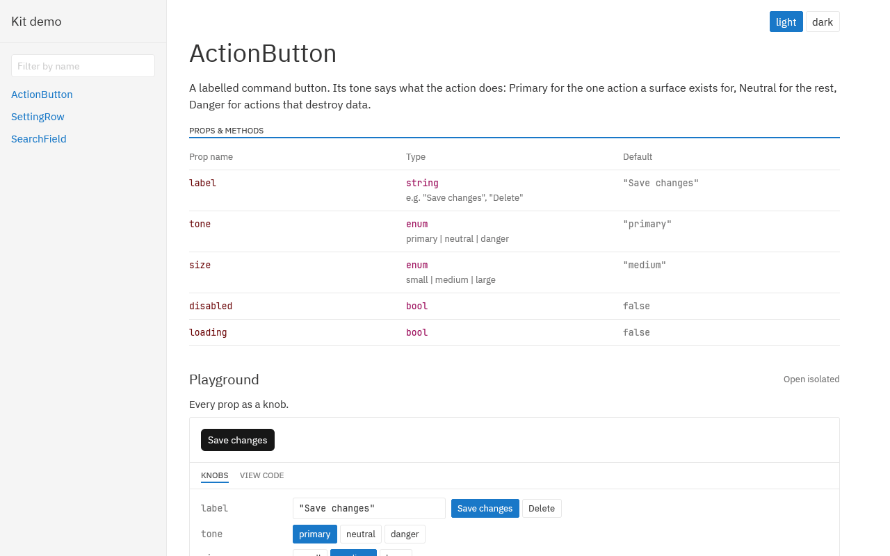

# gpui-styleguidist

**Write one example per GPUI component. Get a live web playground, previews on
docs.rs, copy-pasteable code and visual regression tests from it.**



_The kit-demo styleguide running in a browser as WebAssembly: knobs change the
live component, "View code" prints the Rust for the current values, and every
documented state sits on one page with its own code.
[Try it live](https://gpui-styleguidist.tznc.net/demo/)._

gpui-styleguidist is [React Styleguidist](https://react-styleguidist.js.org)
for [GPUI](https://www.gpui.rs). You describe a component once, as an ordinary
Rust closure that reads its props from **knobs**. Every output below comes from
that one closure, so the docs cannot drift from the code.

- **Your team can try every prop without building the app.**
  `cargo styleguide build` compiles the styleguide to WebAssembly and writes a
  static site you can host anywhere: a filterable sidebar, a page per component
  with its description and props table, and live examples. Each example links
  by URL, such as `#/Button` or `#!/button/primary?disabled=true`.
- **The code on the page compiles.** "View code" shows the closure with each
  knob replaced by its current value, for example
  `.with_size(Size::Small).disabled(true)`, and Copy puts it on the clipboard.
- **Your docs.rs pages show the component, not just its signature.**
  `-- render` snapshots every example, theme and knob combination to PNGs.
  `#[preview("button/primary")]` embeds them in rustdoc, where knobs swap the
  snapshots and update the code. docs.rs serves rustdoc without a
  Content-Security-Policy, so all of this works there.
- **CI catches visual changes.** `-- check` re-renders every snapshot and fails
  on any pixel difference.
- **Every state is documented on one page.** `.state("Disabled", [("disabled",
  "true")])` adds a named state with its own preview and code.
- **Language models get your components too.** `cargo styleguide llms` writes an
  [llms.txt](https://llmstxt.org) index and a Markdown page per component, with
  its props, defaults and the Rust for every example.
- **Edits show up without losing your place.** `cargo styleguide dev` and
  `serve --watch` rebuild on save and reopen at the same example, theme and
  knob values. Knobs never reset unless you press "Reset knobs".

It works with any GPUI component library. The demo in
[`examples/kit-demo`](examples/kit-demo) documents components built on
[gpui-kit](https://gpui-kit.com).

## Get started

1. Add the crate and an example target (see [Writing examples](#writing-examples)).
2. Run `cargo run --example styleguide` to open the styleguide in a window.
3. Run `cargo styleguide serve` to see it in the browser.
4. Run `cargo run --example styleguide -- render` and commit `styleguide/` to
   get the docs.rs previews and the CI check.

## Writing examples

```rust
use gpui_styleguidist::{Example, Styleguide};

pub fn styleguide() -> Styleguide {
    Styleguide::new("My components")
        .assets(my_assets())
        .setup(gpui_kit::init)
        // Host every window in the app's root view (gpui-kit needs its Root).
        .open_window(|options, frame, cx| Ok(gpui_kit::open_window(options, cx, frame)?.0))
        .themes(["light", "dark"], |theme, cx| {
            let mode = if theme == "dark" { ThemeMode::Dark } else { ThemeMode::Light };
            Theme::change(mode, None, cx);
        })
        .background(|cx| cx.theme().background)
        .describe("Button", "Buttons trigger actions.")
        .example(
            example!("button/primary", |knobs, _, _| {
                Button::new("save")
                    .label(knobs.text("label", "Save"))
                    .with_size(knobs.pick(
                        "size",
                        &[("small", Size::Small), ("medium", Size::Medium)],
                        "medium",
                    ))
                    .disabled(knobs.bool("disabled", false))
            })
            .component("Button")
            .description("Use one primary button per surface.")
            .state("Default", [])
            .state("Disabled", [("disabled", "true")])
            .state("Compact", [("size", "small"), ("label", "OK")]),
        )
}
```

- **"View code" is code you can paste.** `example!` captures the closure
  body as written and turns every `knobs.*(…)` read into a slot. "View code"
  fills each slot with the knob's current value, so with size set to small
  and disabled on it shows `.with_size(Size::Small).disabled(true)`, and Copy
  puts that on the clipboard. Read knobs inline where the value is used, and
  use `pick` for values that aren't strings, numbers or bools: it shows the
  option's expression as written. `Example::new(…).source(…)` is the
  macro-free form, which shows fixed text.

- **Knobs are declared by reading them.** They include `bool`, `select`,
  `pick`, `text`, `text_samples` and `number`. The gallery shows a control for each
  one, and `render` snapshots every finite combination (bools, selects, text
  samples) up to `variant_limit`.
- **Example ids are paths.** An id names the example's snapshot directory,
  so it is `/`-separated names, with no empty, `.` or `..` segment, and is
  unique. Every command refuses to run otherwise.
- **`example!(…)` is for stateless elements.** `example!(view …)` is for
  components that need an entity, such as an input's `InputState`. It is
  rebuilt on every knob change.
- **Knobs build the props table.** The knobs a component's examples read make
  up its "Props & methods" table.
- **States document several looks on one page.** Each `.state(name, values)`
  is a set of knob values written as a link carries them; knobs it leaves
  out keep their defaults. The component page and rustdoc show every state
  side by side, each with its own preview and the code that produces it, and
  `render` snapshots every state even past `variant_limit`.
- **The sidebar lists one page per component.** A component appears once it
  has examples; a `describe` alone adds no page.

The entry point is an ordinary example target:

```rust
// examples/styleguide.rs
fn main() {
    gpui_styleguidist::main(my_crate::styleguide());
}
```

```toml
# Cargo.toml
[dependencies]
gpui-styleguidist = { version = "0.1", default-features = false, features = ["macros"] }

[target.'cfg(not(target_family = "wasm"))'.dev-dependencies]
gpui-styleguidist = { version = "0.1", features = ["gallery", "render"] }

[target.'cfg(target_family = "wasm")'.dev-dependencies]
gpui-styleguidist = { version = "0.1", features = ["web"] }

[[example]]
name = "styleguide"
```

## Building the web styleguide

```sh
cargo install cargo-styleguide
cargo install wasm-bindgen-cli --version <the wasm-bindgen version in Cargo.lock>
rustup toolchain install nightly --target wasm32-unknown-unknown

cargo styleguide serve            # build (debug) and serve on http://127.0.0.1:8000
cargo styleguide build --release  # write target/styleguide/<package>/
# Smaller download: add a profile with opt-level = "z", lto = true and
# codegen-units = 1, then pass --profile <name> (see this repo's Cargo.toml).
```

The site is `index.html`, `styleguide.js` and `styleguide_bg.wasm`. Upload the
folder as it is.

On the web:

- **Nightly is required.** GPUI's wasm scheduler uses unstable `std::arch`
  APIs. `cargo styleguide` runs the wasm build through `rustup run nightly`;
  use `--toolchain` to pick another toolchain.
- **There are no system fonts.** The `web` feature bundles IBM Plex Sans for
  GPUI's `.SystemUIFont`. Add any other font your theme names with
  `Styleguide::fonts`.
- **Assets must work in the browser.** gpui-kit fetches icons over HTTP on the
  web (see the demo's `assets()`).

## Documentation for language models

```sh
cargo styleguide llms                         # target/styleguide/<package>/
cargo styleguide llms --out-dir docs/llms     # llms.txt, llms-full.txt, llms/*.md
cargo styleguide llms --out-file COMPONENTS.md
cargo styleguide llms --out-file - | pbcopy   # stdout
```

This reads `styleguide/manifest.json`, so run `render` first. It writes:

- **`llms.txt`**, an [llms.txt](https://llmstxt.org) index linking each
  component's page.
- **`llms/<Component>.md`**, one page per component. It has the description,
  a props table with each prop's builder method, type, values and default,
  and Rust code for every example and state.
- **`llms-full.txt`**, every page in one file. `--out-file` writes only this.

`cargo styleguide build` adds the same files to the site when the manifest
exists. `--out-dir` sets where `build`, `serve` and `llms` write; `--out` is
the same option.

## Reloading while you work

```sh
cargo styleguide dev               # native: rebuild and reopen on every save
cargo styleguide serve --watch     # web: rebuild the wasm and reload the page
```

Both watch the package and every local crate it builds from.

- **`dev`** rebuilds the native styleguide and reopens it at the same example,
  theme and knobs. Natively, a rebuild usually takes a few seconds.
- **`serve --watch`** rebuilds the wasm and reloads the page. The URL keeps
  the example, theme and knobs. Wasm rebuilds are slower than native ones, so
  prefer `dev` for quick iteration.
- **A failed build keeps the last good one running.** The errors print in the
  terminal.
- **Knobs never reset on their own.** Every value you set is remembered per
  example, across reloads, rebuilds, theme switches and navigation, until you
  press "Reset knobs". The web keeps them in `localStorage`; natively they
  sit next to the styleguide executable in
  `<executable>.<styleguide name>.knobs.json`.

This rebuilds and restarts; it does not patch the running code.
[subsecond](https://crates.io/crates/subsecond) hot-patching only patches the
binary crate, and your components live in a library.

## Previews in rustdoc and on docs.rs

```rust
/// A button.
#[gpui_styleguidist::preview("button/primary")]
pub struct Button { /* … */ }

// In module or crate docs:
#![doc = gpui_styleguidist::preview_html!("button/primary", variants = false)]
```

```toml
[package.metadata.docs.rs]
rustdoc-args = ["--html-in-header", "styleguide/header.html"]
```

```sh
cargo run --example styleguide -- render   # write styleguide/ (commit it)
cargo run --example styleguide -- check    # compare; mismatches go to target/styleguide-check/
cargo rustdoc --open -- --html-in-header styleguide/header.html   # what docs.rs builds
```

- **Snapshots are committed and inlined.** docs.rs builds without a GPU or
  network, so the macros inline the committed PNGs as data URLs. Keep the
  snapshots in the published package; crates.io allows 10 MB.
- **Missing snapshots don't break the build.** A missing snapshot shows a note
  in the docs instead.
- **Previews can link to the hosted playground.** Call
  `Styleguide::playground_url(url)` before rendering, and each preview gets
  "Open live playground", which embeds `<url>#!/<id>?<knobs>`.

Rendering uses GPUI's real offscreen renderer: Metal on macOS, WGPU on Linux
(lavapipe works in CI). Text rasterizes differently across platforms, so
render and check on the same platform.

## Version pinning

gpui-styleguidist pins the exact `gpui-pre` snapshot that gpui-kit 0.7.3
uses (`=0.3.9`). Your crate must resolve the same GPUI.

## Layout

| Path | What it is |
|---|---|
| `crates/styleguidist` | `gpui-styleguidist`: examples, knobs, the styleguide UI, the web runtime, render, check and the rustdoc header |
| `crates/macros` | `example!`, `#[preview]`, `preview_html!` |
| `crates/manifest` | The snapshot manifest format shared by the runtime and the macros |
| `crates/cli` | `cargo-styleguide`: the wasm static-site builder and preview server |
| `examples/kit-demo` | gpui-kit components documented end to end, with committed snapshots |
| `website` | The Docusaurus landing page, built from this README |

## Website

[gpui-styleguidist.tznc.net](https://gpui-styleguidist.tznc.net) is this README
as a [Docusaurus](https://docusaurus.io) page (`website/`), with the kit-demo
styleguide at [`/demo/`](https://gpui-styleguidist.tznc.net/demo/). The Pages
workflow builds both and deploys them to the `gpui-styleguidist` Cloudflare
Pages project on every push to main, and to a preview branch for pull requests.
It needs the `CLOUDFLARE_API_TOKEN` (Cloudflare Pages: Edit) and
`CLOUDFLARE_ACCOUNT_ID` repository secrets.

```sh
cd website && npm install && npm start   # the landing page; edit README.md, not website/
```

## Releasing

Bump `version` in the workspace `Cargo.toml` (and the matching
`workspace.dependencies` versions), merge, then publish a GitHub release tagged
`v<version>`. The Publish workflow checks the tag against the version and
publishes `gpui-styleguidist-manifest`, `gpui-styleguidist-macros`,
`gpui-styleguidist` and `cargo-styleguide` in that order, using the
`CARGO_REGISTRY_TOKEN` repository secret. Versions already on crates.io are
skipped, so a failed run can be re-run.

## License

Apache-2.0. The bundled IBM Plex Sans and JetBrains Mono fonts are under the SIL Open Font License; see
[`crates/styleguidist/fonts/OFL.txt`](crates/styleguidist/fonts/OFL.txt).
